  

  
  
  
  
  

  

## 🧑‍💻 About me

I build systems that collect messy data from the web at scale — and the AI agents that keep them running.

- 🕷️ **Software Engineer at [EDITED](https://edited.com)** — extraction, parsing, cleaning and deduplication of retail data at scale with **Scrapy**, proxy management and anti-bot handling
- 🤖 Building **agentic AI systems** that automate engineering workflows
- 📱 Built and shipped **[Pulsify](https://play.google.com/store/apps/details?id=com.apex.fitness)** solo — an AI fitness & nutrition app, live on Google Play
- 🎓 Computer Systems and Technologies @ Technical University of Varna
- 🌱 Currently exploring **AI red-teaming & prompt-injection security** and **distributed systems**

 

  

## 🛠️ Tech stack

<table>
<tr>
<td width="170"><b>Languages</b></td>
<td>

</td>
</tr>
<tr>
<td><b>Scraping & data</b></td>
<td>

</td>
</tr>
<tr>
<td><b>Backend & AI</b></td>
<td>

</td>
</tr>
<tr>
<td><b>Distributed systems</b></td>
<td>

</td>
</tr>
<tr>
<td><b>Frontend & mobile</b></td>
<td>

</td>
</tr>
<tr>
<td><b>Web3</b></td>
<td>

</td>
</tr>
<tr>
<td><b>Infra & tools</b></td>
<td>

</td>
</tr>
</table>

<i>Most of my work lives in private repositories — happy to walk you through it on <a href="https://www.linkedin.com/in/donko-tonev/">LinkedIn</a>.</i>

